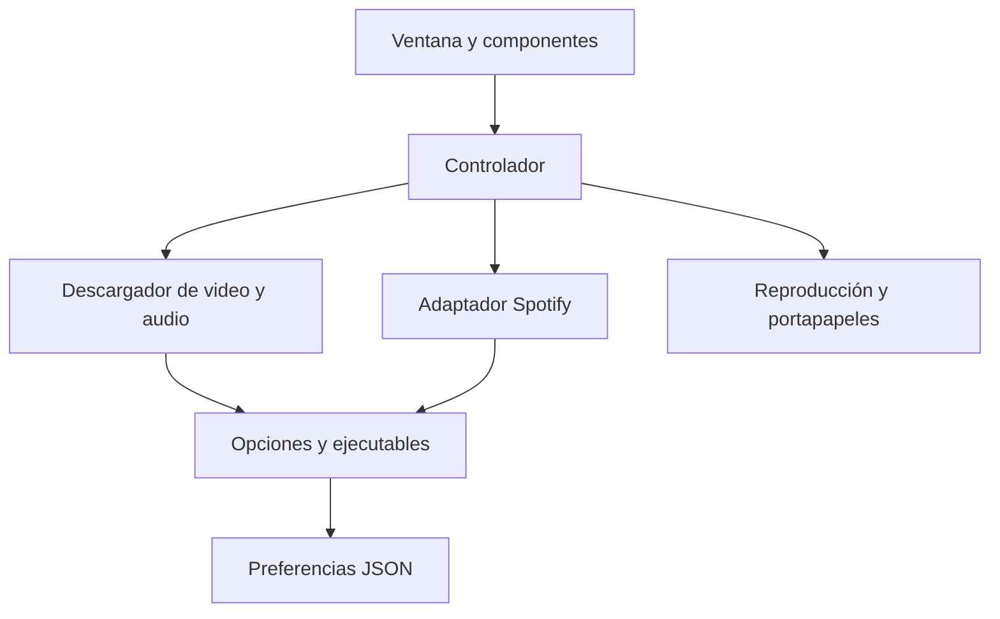

# Arquitectura

## Organización y responsabilidades

| Módulo | Responsabilidad |
| --- | --- |
| `main.py` | Entrada; invoca la función principal de la aplicación |
| `src/app.py` | Construcción de ventana, ensamblaje de componentes y diálogo de dependencias |
| `src/gui/components/` | Controles, selección de formatos, resultados y reproductor de video |
| `src/gui/controller.py` | Coordina análisis, descargas, avances y actualizaciones de interfaz |
| `src/video_downloader.py` | Metadatos, búsquedas, descargas y posprocesadores FFmpeg |
| `src/spotify_downloader.py` | Metadatos públicos de Spotify y búsqueda de audio en YouTube |
| `src/runtime.py` | Localización de ejecutables y opciones comunes de yt-dlp |
| `src/urls.py` | Clasificación de entrada sin depender de GUI ni del motor de descarga |
| `src/config.py` | Preferencias JSON y escritura atómica |
| `src/dependency_checker.py` | Verificación, instalación local de FFmpeg y actualización de yt-dlp |
| `src/gui/preview_manager.py` | Estado y operaciones de reproducción de audio |
| `src/gui/clipboard_manager.py` | Copia de archivos mediante PowerShell en Windows |

## Flujo de una descarga

El controlador lee formato, calidad, carpeta, recorte y opciones desde los widgets antes de iniciar el hilo de descarga. El hilo selecciona el adaptador y ejecuta yt-dlp; los hooks publican progreso mediante `ui.after`. La finalización de la transferencia no implica que termine la conversión. El resultado positivo requiere un código de salida cero y al menos una ruta final comunicada por el post hook.

Para una lista, el resultado representa el trabajo conjunto: un error puede dejar elementos ya descargados. El controlador bloquea nuevos análisis y descargas mientras una descarga está activa. La cancelación se consulta desde los hooks de progreso; no interrumpe inmediatamente un proceso FFmpeg que ya esté convirtiendo.

## Decisiones de esta revisión

- Mantener los módulos y firmas públicas para preservar los cambios locales existentes.
- Compartir opciones de cookies y FFmpeg en `runtime.py`, incluso para los avances.
- Resolver `bin/` desde `__file__`, independientemente del directorio de ejecución.
- Clasificar sitios por hostname: un dominio en el texto de una búsqueda, una ruta o los parámetros no identifica una plataforma.
- Mantener habilitada la validación TLS predeterminada de yt-dlp.
- Propagar los errores de los posprocesadores obligatorios; no presentar una conversión fallida como exitosa.
- Guardar preferencias en un temporal del mismo directorio y reemplazar el JSON al terminar. Un bloqueo protege las escrituras de una misma instancia; no coordina procesos distintos.
- Usar `unittest` para regresiones sin añadir dependencias de desarrollo.

## Límites de separación

El controlador sigue conociendo widgets concretos y algunos métodos privados de la ventana. No es una implementación estricta de MVC ni una capa de servicios independiente. La aplicación también conserva un singleton de configuración para compatibilidad; `Config` acepta un directorio alternativo para probar persistencia sin tocar preferencias reales.

Una evolución posterior puede introducir una solicitud de descarga inmutable, un servicio de trabajos cancelables y una cola de eventos de interfaz. Debe acompañarse de pruebas de cierre de ventana, operaciones simultáneas y uso de la interfaz real antes de reemplazar el controlador actual.
